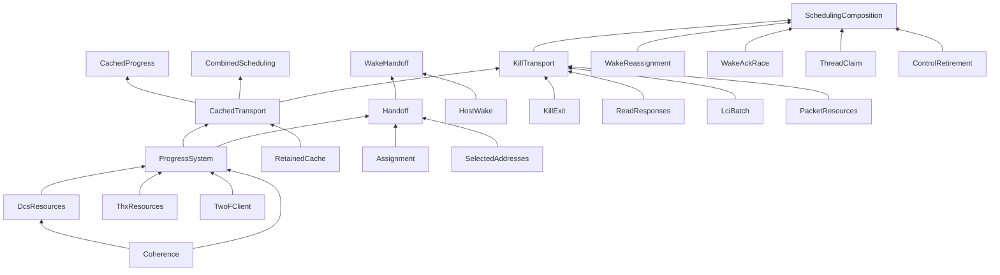

# Formal model structure and verification boundaries

This reference describes TLA+ specifications, finite model checking and their
connections to RTL verification. The selected resource endpoint is LCI/LCIA with
no UL. Current cooperative scheduling models are `IdleDispatch`, `HandoffClaims`
and `PoolBootstrap`; historical wake/close compositions retain their own scope.
Model import graphs do not themselves prove refinement. Architectural motivation
and implemented address geometry belong to the [queue-pair design](../hardware/queue-pair-design.md).

| Directory | Contents |
| --- | --- |
| [`tla/worker`](../../model/tla/worker) | Selected DC/THX table interpreters, single-line exchanges and repeated half-duplex worker operations |
| [`tla/steady`](../../model/tla/steady) | Generic finite resource/cache components and fixed-assignment progress harnesses |
| [`tla/scheduling`](../../model/tla/scheduling) | Focused assignment, wake, kill and control contracts; no concrete coherence state |
| [`tla/contracts`](../../model/tla/contracts) | Shared invalidation and serialized worker-operation interfaces |
| [`tla/common`](../../model/tla/common) | Generic typed messages, ordered channels and buffer ownership |
| [`tla/composition`](../../model/tla/composition) | Cross-layer adapters and optional detailed endpoint products |
| [`config`](../../model/config) | Bounds, TLC properties, import policy and the [contract ledger](../../model/config/contracts.json) |
| [`data`](../../model/data) | Selected address-layout input, independent of verification results |
| [`evidence`](../../model/evidence) | Recorded results and provenance; old paths/hashes remain historical |
| [`legacy/tla`](../../model/legacy/tla) | Frozen original model and Toolbox snapshots, outside the active import graph |

Worker, steady and scheduling layers cannot import each other. The structural
check enforces the reviewed import policy; explicit compositions join them.
Generated ROM/THX table data comes from the selected Nix ROM and extracted THX
JSON, not handwritten replacement transitions.

Generated TLC states, logs, emitted configurations and counterexamples go under
ignored `out/`, not beside the source. The historical Toolbox configurations are
in `config/legacy`, with their old output in `evidence/legacy`. They are not
configurations for today's model.

## Transport components and earlier composition evidence

The graph below records the earlier modeling round. Its host-wake, kill and
combined scheduling harnesses are retained evidence, not interfaces implemented
by the cooperative scheduler. The [October 13 HOST_WORK design](../research/etcd.md#host_work)
uses a new name and distinguishes assigned RX notification from allocation for
unassigned domains; it is not implemented. Historical `HostWake` model names and
their recorded results are unchanged and do not validate the new contract.
Use `IdleDispatch`, `HandoffClaims` and `PoolBootstrap` for the current scheduling
contract; use the transport components below for their stated resource properties.



Arrows mean “used by.” The remaining small harnesses are listed below. Imports
are compositions, **not proofs that one specification refines another**.

| Source | Responsibility / boundary |
| --- | --- |
| `Coherence` | Typed address/transaction records and message unions |
| `DcsResources` | Read slots, per-color admission, ordered invalidation/response queues and acknowledgment acceptance. No domains, scheduling or parity |
| `ThxResources` | Held-read resource pools and conservative acknowledgment admission guard; actual THX credit topology remains assumed |
| `TwoFClient` | One serialized operation per client, parity and dependency sequence. LCIA advances the dependency directly |
| `ProgressSystem` | Synchronizes the preceding components; owns the shared `Quiet` transport predicate and settled resource invariants |
| `RetainedCache` | Residency, directory occupancy, dirty lines, queued replacements and transient invalidation charges |
| `CachedTransport` | Sole adapter between `ProgressSystem` and `RetainedCache`: pins active addresses, prepares cache admission, and releases transient charges on LCIA |
| `Steady`, `CachedProgress` | Fixed-configuration traffic, deliberate stalls, geometry, initial cache history and fairness |
| `Probe` | A second device client of the unchanged generic DCS resource interface |
| `DirectoryAdmission` | Separate CPU fill-reservation/pigeonhole contract; it models requests overtaking queued victims, which `RetainedCache` does not |
| `ReadResponses` | Generic finite ordered read-data channel, transaction identity and capacity; no scheduling policy |
| `AxiReloadGate` | Earlier/queued/buffered reads, held doorbell, stop fencing and independent peer service; [contracts and counterexamples](axi-response-contract.md) |
| `Assignment`, `Reservation` | Cooperative assignment transitions and destination-capacity contention |
| `Handoff`, `SelectedAddresses` | Handoff to the exact Goal 1 predicate using generated selected-layout control addresses |
| `HostWake`, `WakeHandoff`, `WakeRetirement` | Notification ownership, joined host-driven handoff, and callback lifetime; the retirement harness assumes endpoint retirement |
| `WakeReassignment`, `WakeAckRace` | Delayed stale routing hints across A→B→A, and notification versus command acknowledgment. These are different races |
| `DomainIsolation` | [Multiple domain PAs per worker, inactive access to kill, delayed TX admission and payload provenance](domain-isolation.md) |
| `IdleDispatch`, `HandoffClaims`, `PoolBootstrap` | Current idle/ordinary activation, simultaneous domain exchange, fresh return and immutable pool publication |
| `ThreadClaim` | Fixed preinitialized thread pool, NIC reservation and atomic kernel claim/retry |
| `ControlRetirement` | Immutable MMIO response and close/callback ordering, with abstract endpoint readiness |
| `LciBatch`, `PacketResources` | Generic ordered cleanup client and buffer/writeback ownership components |
| `KillTransport` | [Kill control plus RX/TX cleanup](kill-exit.md#resource-backed-kill-cleanup), stalled worker and repeating peer; imports existing safety/progress properties |
| `SchedulingComposition` | [Joined wake/claim/handoff/kill races](scheduling.md#joined-scheduling-wake-and-transport), importing focused properties and resource-backed successor traffic |
| `KillExit` | Whole-domain kill/exit, either IRQ/RX-release order, no prefix reuse, retained cache allowed. Tail cleanup is abstract |
| `InterruptGate`, `TimerMirror` | Release-first interrupt diagnostic and ordered timer command delivery. Neither requires interrupts for cooperative DESCHED |
| `CombinedScheduling` | Bounded joint control state plus the shared cached transport; see the limits below |

For the historical joined race evidence, follow `SchedulingComposition` and its
instances. It is not a refinement proof of the current scheduler. Source,
bounds/configuration, and checked evidence remain separate.

## State ownership and ports

Components export their state tuples and actions. A containing harness declares
shared variables and instantiates components with `INSTANCE` (and `WITH` for
substitution). It adds `UNCHANGED` for its own variables. Each adapter action
frames **all** adapter state; it never mutates a scheduler variable. Local tuple
aliases are intentionally explicit: TLC 1.8 fails when evaluating some nested
`UNCHANGED` expressions through imported tuple aliases.

`CachedTransport` has no `Spec` and no fairness assumptions. Its caller chooses
initial cache history, eligibility and environmental backpressure, then applies
fairness to the **guarded** action. `ProgressSystem!Spec` is the uncached harness
contract; cache-aware compositions use its actions, not that unguarded Spec.

| Boundary | Submission / acceptance / release |
| --- | --- |
| Client → DCS read | `Admit` atomically allocates the THX held-read slot and DCS color/slice slot; `Return` releases both |
| Client → invalidation queue | `Inv` appends a record containing transaction and full line address; queue depth applies before acceptance |
| DCS → endpoint processing | `Process` changes the FIFO head to an Ack only when its target read resource is free; the cache adapter also excludes queued victim or prior invalidation conflicts |
| Endpoint → client completion | `Ack` accepts LCIA, pops that same FIFO head, releases any retained invalidation charge and advances the client. No subsequent release message exists |
| CPU replacement → directory | `Evict` removes residency but queues a downgrade/writeback and retains the directory charge; `Deliver` releases it only when the harness's service guard permits |
| Scheduling → transport | Harness eligibility gates `Admit`; `Quiet` describes outstanding transactions, **not** cache cleanliness. Ordinary handoff does not flush old-domain lines |

Queue order and repeated messages are preserved with sequences. Event sets in
wake models represent uniquely identified bounded notifications, not ECI link
queues. Their bounds do not establish an unbounded notification-generation proof.

## What remains deliberately separate

`CombinedScheduling` instantiates the resource adapter, but its `ctl` record
**restates** the focused reservation/claim/close/wake contracts. It does not
instantiate those focused state machines, and no refinement mapping between
these representations has been proved. Its one notification per domain does not
cover the two-generation `WakeAckRace` by composition. Keep those focused
negative cases until that correspondence exists; combining everything into one
large Spec would obscure these gaps and make temporal checking harder.

Optional prefix-reuse certificates in `Handoff`, `ControlRetirement` and the
combined harness remain stronger than the selected monotonic-allocation kill
policy. They assume endpoint retirement; `KillExit` permits cached old lines to
remain. Neither a kernel cache flush nor an activation commit write is implied.

The low-level suites check selected single-line histories and repeated worker
operations, not every THX race. General single-line correctness, independent THX replacement/response service,
exact writeback/data-buffer timing and hardware correspondence of kill TX/overflow cleanup, and hardware conformance to the
[AXI response contracts](axi-response-contract.md) remain undischarged. See the
[review and current evidence](model-structure.md#module-review-evidence-and-historical-sources) and
[implementation checklist](../software/scheduling-implementation-checks.md).

## Layers and boundaries

| Layer | Owns | Assumes from below | Independently checked |
| --- | --- | --- | --- |
| Single worker (`model/tla/worker`) | Selected DC FSM, extracted THX remote FSM, line messages, AXI read/write completion, serialized 2F2F control/overflow sequencing | Correct message framing and modeled endpoint service capabilities; no shared-resource contention inside one admitted line | Legal transitions, address identity, no premature LCIA, doorbell completion ordering, repeated worker progress, projections to the public contracts |
| Steady state (`model/tla/steady`) | Colors, queues, finite shared resources, admission, retained cache/directory accounting and stalled workers | Eligible lower-level exchanges satisfy the completion contract | Resource conservation, transaction tracking, compatible settled configurations, admission and completion of independent peers/bypass |
| Scheduling (`model/tla/scheduling`) | Assignment, reservation/claim, DESCHED, wake ownership, kill and MMIO/control races | Abstract transport readiness/retirement and progress obligations | Local safety/races/liveness; coupled obligations are checked by composition harnesses |

`model/tla/common` holds generic message/buffer helpers.
`model/tla/contracts` holds the shared interfaces. Cross-layer wiring lives in
`model/tla/composition`: Handoff, cached kill cleanup, scheduling composition,
AXI response diagnostics, and optional detailed endpoint expansions.
The structural check rejects worker→steady/scheduling, steady→worker/scheduling,
and scheduling→worker/steady/composition imports. A composition harness may
import the layers it joins. This separates ownership without pretending that
moving a file proves its assumptions.

## Public contracts

The machine-readable [contract ledger](../../model/config/contracts.json)
records providers, consumers, properties, assumptions and scope.

- **`InvalidationPort`**: ordered address/transaction records progress from
  submission to a completion certificate to acceptance. `Complete` is an
  abstract certificate that all required response/data service finished; it is
  not an implementation of that service. `DcsResources` uses this same action
  with its resource-eligibility guard. The port contains no fairness assumption.
- **`TwoFClient`**: one serialized worker operation, parity, an ordered dependency
  sequence, and return. `SingleWorker` checks the same operation relation that
  `ProgressSystem` uses. No scheduler or DC opcode enters this interface.
- **`ProgressSystem`**: `Settled`, `Quiet`, `ProgressFor` and `AdmissionFor` are
  reused by the cross-layer handoff/kill harnesses. Quiet means no outstanding
  transport, not a clean or empty CPU cache. Scheduling components do not inspect
  concrete DC/THX states.

Do not turn a provider's liveness obligation into unconditional fairness on
abstract completion. Fairness belongs on actions **after** resource/environment
eligibility guards have been applied. In particular, disabled AXI write service
cannot be repaired by fairness.

## Concrete low-level checks

`tools/model/coherence_tables.py` translates the selected Nix-generated ROM SV
into all 252 explicit entries (14 states × 18 events), and the unmodified THX
JSON into all 117 transitions. It preserves forbidden/stall entries; the harness
can detect forbidden processing. No handwritten replacement ROM or THX equations
are installed. Hashes of both inputs and the translator are retained.

`LineEndpoint` connects those tables using typed, address-qualified messages,
separate read completion, write-data acceptance and write-response acceptance.
It includes the contextual no-data HAKD decode. Link ordering is a bounded FIFO
configuration; the test does not claim that all ECI virtual channels share one
FIFO. These single-exchange histories contain no competing remote request, so
they do not cover the whole space of VC reorderings.

The configured checks cover cold RX/shared-load and TX/exclusive-load requests,
legal retained shared/exclusive states, absent LCI, and a one-slot link boundary.
They check completion soundness and the state/action projection to
`InvalidationPort!Behavior`. Negative cases expose missing RX write service and
premature acknowledgment. A witness reaches data-bearing HAKD after a load with
no intervening software store. The FSM models data/no-data, not literal dmask
bits or payload values.

`SingleWorker` composes actual line exchanges with the public worker operation
contract. Its doorbell's DC RDD stays held while opposite-control and two overflow
lines are invalidated. Required returned data must complete independently before
LCIA; the doorbell response is released only after all dependencies finish.
Both initial parities and repeated operations are checked, including serialized
RX/TX directions. Reused invalidated targets can take an actual new THX load and
DC refill before their next invalidation. This is an abstract 2F2F client, not a
transcription/refinement of the Spinal worker RTL. TX payload values, packet
semantics and speculative overlap outside the configured histories remain out
of scope.

## Mechanical composition without one mandatory large state space

TLC checks two kinds of correspondence:

1. `LineEndpoint!PortRefinement` and `SingleWorker!OperationRefinement` check
   imported abstract initialization and next-state relations under explicit state
   substitutions. Hidden coherence steps must stutter in these projections.
2. `DetailedSteady` replaces only the resource harness's abstract completion with
   the concrete endpoint exchange. It checks the imported steady-state safety,
   admission and progress properties, plus `AbstractBehavior`. The default bound
   has one indefinitely stalled worker and one progressing worker. Disabling
   write service fails progress here too.

The expanded steady check starts each target exchange in a resident exclusive
entry state and explicitly re-establishes that entry between exchanges. It does
not reproduce cache replacement; `CachedProgress` continues to check that shared
resource contract separately. Independent writes are a capability assumption;
undocumented shared THX response buffers are not proved by copying an endpoint.

An opt-in `ExpandedScheduling` product gates completion in the **unchanged**
`SchedulingComposition!Next` and advances detailed line endpoints between its
steps. It takes entry residency from the resource model and checks imported
scheduling safety plus the abstract behavior projection. It intentionally has
**no full-product liveness claim**: using the old abstract fairness clauses
unchanged would assume away a blocked concrete completion. Lower-level race
coverage and fair service through every concrete shared resource still need
separate justification before that progress claim can be made.

These finite checks are not a mechanized assume-guarantee theorem that proves
all bounds. They make each interface and the checked substitution concrete,
keep the inexpensive layer suites independent, and provide optional products
for finding mismatches. Composition imports alone are not evidence of refinement.

## Reproduce and remaining obligations

The Nix check builds the ROM and uses pinned `tlaplus18`; generated tables,
flattened source snapshots, effective configs, logs and counterexamples stay in
ignored outputs. Existing layer suites retain their names and bounds.

```sh
nix build .#checks.x86_64-linux.tla-modules
nix build .#checks.x86_64-linux.coherence-layers
nix build .#checks.x86_64-linux.steady-progress
nix build .#checks.x86_64-linux.scheduling-races
nix build .#dcsRom --out-link out/layered-rom
nix develop -c python3 tools/model/check_layers.py \
  --rom out/layered-rom --case expanded-scheduling-safety \
  --output out/layered-full-product --timeout 7200
```

Before claiming full low-level correctness, extend histories to conflicting
CPU requests/evictions, responses in flight and legal independent VC reordering;
include actual finite shared write/data/response resources. Establish the RTL
correspondence for the DC decoder, framing, AXI sink and 2F2F worker. The extracted
THX FSM remains an evidence-backed endpoint assumption, not a proof of THX
internals. Board conformance and the RTL RX sink regression are separate evidence.
The historical large scheduling results remain conditional and are not relabeled
as newly rerun merely because their modules moved.

## Recorded layered results — October 2, 2026

[Tracked summaries](../../model/evidence/layered) preserve source, generated-table,
configuration and log fingerprints. A passing negative case means TLC found the
specified violation, not that the injected design is correct.

| Run | Outcome |
| --- | --- |
| Nix `tla-modules` | Inventory, import boundaries, contract inventory and SANY passed |
| Nix `coherence-layers` | All 14 outcomes matched; includes five negative/witness cases |
| Repeated single worker / serialized RX–TX | 250 / 2,280 distinct states; safety, projection and repeated progress passed |
| Expanded steady state | 352 distinct states; stalled-peer safety, admission, progress and projection passed |
| Optional expanded scheduling | 23,612 distinct states; safety and projection passed, **kill-only, zero wake budget**, no liveness check |
| Existing steady suite | All 14 positive/negative outcomes matched |
| Focused scheduling races | All 16 outcomes matched |
| Transport/handoff suite | All eight outcomes matched |
| Focused joined scheduling | `full-roundtrip`, `full-claim-contention`, `full-reservation-roundtrip`, `bad-full-drain` matched |

The larger full scheduling rerun was stopped in favor of these focused
regressions; it supplies no new passing result. Existing historical large-suite
results remain in their original reports. Neither the optional kill-only product
nor the separate wake checks establish a detailed coherence-plus-wake liveness
result. The ROM's 252 entries and THX's 117 transitions are available to the
interpreters; these narrow software histories do not exercise all of them.

## Module-review evidence and historical sources

The October 1, 2026 [module review](../../model/evidence/module-review.json)
records 81 TLC outcomes (34 positives and 47 expected counterexamples/witnesses),
including combined state invariants over 2,528,455 states, and SANY checks of the
then-28-module inventory. These are results for the recorded source hashes;
moving documentation does not rerun them. Full combined temporal properties were
not established by that review. The review removed vacuous `bad-drain` and
`bad-combined-info` diagnostics after UL removal; a negative control must still
reach its intended fault to count as coverage.

The original canonical `model/legacy/tla/lauberhorn.tla` and its differing Toolbox
snapshots use READY/BUSY and interrupt-driven scheduling, set-valued links and no
finite DCU resource model. Their source/configuration/evidence bytes remain in
`model/legacy/tla`, `model/config/legacy` and `model/evidence/legacy`. Reproduction
requires matching TLA and CFG files in an isolated working directory. Inclusion
of the canonical legacy source in SANY is not a current model-checking result.
Removed auto-lock models such as `LateUnlock` and `DcsDirectoryCycle`, with their
original configurations, are available at Git revision `4cb1e8a`.
