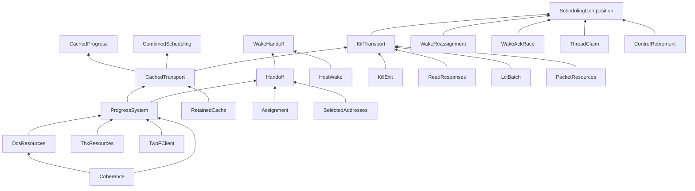

# TLA+ models

The active model is the **LCI-only endpoint** with cooperative scheduling. Start
with [ProgressSystem](tla/steady/ProgressSystem.tla), then
[CachedTransport](tla/steady/CachedTransport.tla), then
[Handoff](tla/scheduling/Handoff.tla) and
[CombinedScheduling](tla/scheduling/CombinedScheduling.tla).

| Directory | Contents |
| --- | --- |
| [`tla/steady`](tla/steady) | Resource components and steady-state harnesses; TLA+ source only |
| [`tla/scheduling`](tla/scheduling) | Assignment component, focused race contracts and composition harnesses; TLA+ source only |
| [`config/steady`](config/steady) | TLC configurations for steady-state bounds and fault cases |
| [`config/scheduling/suite.json`](config/scheduling/suite.json) | Scheduling bounds, fault injections, checked properties and named suites; the runner emits each effective `.cfg` |
| [`data`](data) | Selected address-layout input, independent of verification results |
| [`evidence`](evidence) | Recorded results and provenance; old source paths/hashes remain historical |
| [`legacy/tla`](legacy/tla) | Frozen original model and Toolbox source snapshots, outside the active import graph |
| [`config/modules.json`](config/modules.json) | Reviewed import allow-list and role of every canonical module |

Generated TLC states, logs, emitted configurations and counterexamples go under
ignored `out/`, not beside the source. The historical Toolbox configurations are
in `config/legacy`, with their old output in `evidence/legacy`. They are not
configurations for today's model.

## Components and composition



Arrows mean “used by.” The remaining small harnesses are listed below. Imports
are compositions, **not proofs that one specification refines another**.

| Source | Responsibility / boundary |
| --- | --- |
| `Coherence` | Typed address/transaction records and message unions |
| `DcsResources` | Read slots, per-color admission, ordered invalidation/response queues and acknowledgment acceptance. No domains, scheduling or parity |
| `ThxResources` | Held-read resource pools and conservative acknowledgment admission guard; actual THX credit topology remains assumed |
| `TwoFClient` | One serialized operation per client, parity and dependency sequence. LCIA advances the dependency directly |
| `ProgressSystem` | Synchronizes the preceding components; owns the shared `Quiet` transport predicate and settled resource invariants |
| `RetainedCache` | Residency, directory occupancy, dirty lines, queued replacements and transient invalidation charges |
| `CachedTransport` | Sole adapter between `ProgressSystem` and `RetainedCache`: pins active addresses, prepares cache admission, and releases transient charges on LCIA |
| `Steady`, `CachedProgress` | Fixed-configuration traffic, deliberate stalls, geometry, initial cache history and fairness |
| `Probe` | A second device client of the unchanged generic DCS resource interface |
| `DirectoryAdmission` | Separate CPU fill-reservation/pigeonhole contract; it models requests overtaking queued victims, which `RetainedCache` does not |
| `ReadResponses` | Generic finite ordered read-data channel, transaction identity and capacity; no scheduling policy |
| `AxiReloadGate` | Earlier/queued/buffered reads, held doorbell, stop fencing and independent peer service; [contracts and counterexamples](../docs/hardware/axi-response-contract.md) |
| `Assignment`, `Reservation` | Cooperative assignment transitions and destination-capacity contention |
| `Handoff`, `SelectedAddresses` | Handoff to the exact Goal 1 predicate using generated selected-layout control addresses |
| `HostWake`, `WakeHandoff`, `WakeRetirement` | Notification ownership, joined host-driven handoff, and callback lifetime; the retirement harness assumes endpoint retirement |
| `WakeReassignment`, `WakeAckRace` | Delayed stale routing hints across A→B→A, and notification versus command acknowledgment. These are different races |
| `ThreadClaim` | Fixed preinitialized thread pool, NIC reservation and atomic kernel claim/retry |
| `ControlRetirement` | Immutable MMIO response and close/callback ordering, with abstract endpoint readiness |
| `LciBatch`, `PacketResources` | Generic ordered cleanup client and buffer/writeback ownership components |
| `KillTransport` | [Kill control plus RX/TX cleanup](../docs/hardware/kill-transport-composition.md), stalled worker and repeating peer; imports existing safety/progress properties |
| `SchedulingComposition` | [Joined wake/claim/handoff/kill races](../docs/hardware/scheduling-composition.md), importing focused properties and resource-backed successor traffic |
| `KillExit` | Whole-domain kill/exit, either IRQ/RX-release order, no prefix reuse, retained cache allowed. Tail cleanup is abstract |
| `InterruptGate`, `TimerMirror` | Release-first interrupt diagnostic and ordered timer command delivery. Neither requires interrupts for cooperative PREEMPT |
| `CombinedScheduling` | Bounded joint control state plus the shared cached transport; see the limits below |

For the current joined race model, start with `SchedulingComposition` and follow
its instances. Source, bounds/configuration, and checked evidence remain separate.

## State ownership and ports

Components export their state tuples and actions. A containing harness declares
shared variables and instantiates components with `INSTANCE` (and `WITH` for
substitution). It adds `UNCHANGED` for its own variables. Each adapter action
frames **all** adapter state; it never mutates a scheduler variable. Local tuple
aliases are intentionally explicit: TLC 1.8 fails when evaluating some nested
`UNCHANGED` expressions through imported tuple aliases.

`CachedTransport` has no `Spec` and no fairness assumptions. Its caller chooses
initial cache history, eligibility and environmental backpressure, then applies
fairness to the **guarded** action. `ProgressSystem!Spec` is the uncached harness
contract; cache-aware compositions use its actions, not that unguarded Spec.

| Boundary | Submission / acceptance / release |
| --- | --- |
| Client → DCS read | `Admit` atomically allocates the THX held-read slot and DCS color/slice slot; `Return` releases both |
| Client → invalidation queue | `Inv` appends a record containing transaction and full line address; queue depth applies before acceptance |
| DCS → endpoint processing | `Process` changes the FIFO head to an Ack only when its target read resource is free; the cache adapter also excludes queued victim or prior invalidation conflicts |
| Endpoint → client completion | `Ack` accepts LCIA, pops that same FIFO head, releases any retained invalidation charge and advances the client. No subsequent release message exists |
| CPU replacement → directory | `Evict` removes residency but queues a downgrade/writeback and retains the directory charge; `Deliver` releases it only when the harness's service guard permits |
| Scheduling → transport | Harness eligibility gates `Admit`; `Quiet` describes outstanding transactions, **not** cache cleanliness. Ordinary handoff does not flush old-domain lines |

Queue order and repeated messages are preserved with sequences. Event sets in
wake models represent uniquely identified bounded notifications, not ECI link
queues. Their bounds do not establish an unbounded notification-generation proof.

## What remains deliberately separate

`CombinedScheduling` instantiates the resource adapter, but its `ctl` record
**restates** the focused reservation/claim/close/wake contracts. It does not
instantiate those focused state machines, and no refinement mapping between
these representations has been proved. Its one notification per domain does not
cover the two-generation `WakeAckRace` by composition. Keep those focused
negative cases until that correspondence exists; combining everything into one
large Spec would obscure these gaps and make temporal checking harder.

Optional prefix-reuse certificates in `Handoff`, `ControlRetirement` and the
combined harness remain stronger than the selected monotonic-allocation kill
policy. They assume endpoint retirement; `KillExit` permits cached old lines to
remain. Neither a kernel cache flush nor an activation commit write is implied.

Single-line protocol correctness, independent THX replacement/response service,
exact writeback/data-buffer timing and hardware correspondence of kill TX/overflow cleanup, and hardware conformance to the
[AXI response contracts](../docs/hardware/axi-response-contract.md) remain undischarged. See the
[review and current evidence](../docs/hardware/model-review.md) and
[implementation checklist](../docs/software/scheduling-implementation-checks.md).

## Reproduce

All commands use the locked Nix `tlaplus18` toolchain:

```sh
nix build .#checks.x86_64-linux.tla-modules
nix build .#checks.x86_64-linux.steady-progress
nix build .#checks.x86_64-linux.scheduling-transport
nix build .#checks.x86_64-linux.scheduling-axi
nix build .#checks.x86_64-linux.scheduling-kill-transport
nix build .#checks.x86_64-linux.scheduling-full
nix develop -c python3 tools/scheduling/check_models.py \
  --races-only --output out/review-races --timeout 900 --workers 4
nix develop -c python3 tools/scheduling/check_models.py \
  --case combined-scheduling --safety-only \
  --output out/review-combined --timeout 1200 --workers 4
```

The module check validates inventory, imports, absence of the legacy endpoint,
and SANY semantics. It is not a model check. TLC suites test their configured
properties only; `--safety-only` omits temporal properties, including snapshot
stability. Full combined liveness remains open.
